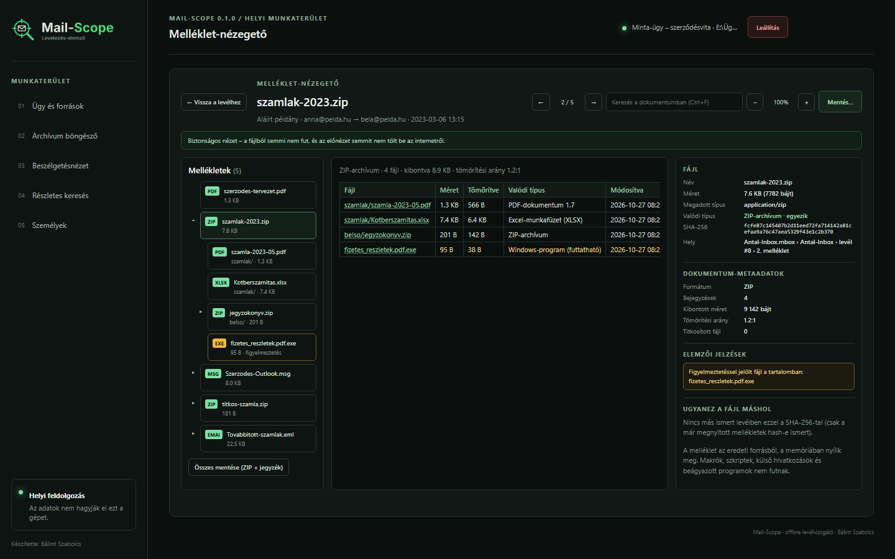

# Mail-Scope

**Creator: Bálint Szabolcs**

Mail-Scope is an offline, local-first mail archive browser and analysis tool. It reads mail archives directly, indexes message metadata and searchable text in a case-local SQLite database, and opens the original message from its source when requested.

> **Development status:** version `0.1.0`. This project is under active development and is not yet a signed or released Windows application. Mail-Scope is licensed under the MIT License; third-party components retain their own licenses.

## Features

- Discover and index MBOX, MBX, MBS, EML, PST, and OST sources, including supported archives inside folders. The EML files of one directory (for example a Mail Extractor output folder) form a single source.
- Read PST/OST files using the optional `libpff-python-windows` binding.
- Search message text, subject, participants, dates, attachments, folders, sources, attachment types, and case-local labels.
- Combine detailed-search conditions in AND/OR groups; save and reload searches.
- Merge duplicate messages in search results while retaining source occurrences and forensic locators.
- Assign labels to all indexed source copies of a selected message.
- Browse conversations by people and export EML messages with SHA-256 manifests.
- Export detailed-search results to CSV or EML ZIP; print a bounded search report to PDF using the browser's print dialog.
- Keep indexes, labels, saved searches, and the case log (`mailscope.log`) inside the case's `.mailscope` directory. The application log is written to `%LOCALAPPDATA%\Mail-Scope\logs\mail-scope.log`.
- Full-text search matches word prefixes, so `szerződés` also finds `szerződést`; use quotes for an exact phrase and `AND`, `OR`, `NOT` as operators.

## Privacy and source integrity

- Mail-Scope does not upload data or use external services, CDNs, or network resources.
- The local server binds to `127.0.0.1` only.
- Source archives are opened read-only. Integrity checks have two levels:
  - **Full SHA-256 calculation** happens at discovery, after indexing, whenever the source's file signature (size, modification time, file identity) differs from the one recorded at the last full hash, and when you press **Teljes újraellenőrzés** next to a source on the **Ügy és források** page. The re-check runs in the background with a progress bar; its result and time are stored in the case database and the case log, and a different hash marks the source as `source_changed`, after which its messages are no longer opened or exported.
  - **Signature check only** happens on every other message open or export: if size, modification time and file identity still match, the last full hash is accepted without reading the whole file. A modification time can be set back deliberately, so use **Teljes újraellenőrzés** when you need a fresh full proof.
  - Each case asks you to decide on the **Ügy és források** page between the fast mode above and a **strict mode**, which re-hashes the whole source before every message open (once per source and export). Strict mode gives a fresh full check for every opened or exported message, but on large PST/OST files each open can take minutes; the page shows an estimate for the case's largest source. Until you decide, the fast mode applies.
  - Each source row shows “Utolsó teljes ellenőrzés: <date, time>”, and every EML ZIP `MANIFEST.txt` records, per message, whether a full hash or only a signature check preceded the export, and when the source was last fully hashed.
- Indexing stores locators and searchable metadata rather than extracting complete mailboxes to disk. MBOX/EML exports preserve the source message bytes (excluding the MBOX envelope line); PST/OST exports reconstruct an EML from available headers, MAPI properties, body, and attachment data.
- Each manifest hash is calculated over the exact EML bytes written into the ZIP. PST/OST files do not contain a single original RFC 5322 message byte stream, so their EML is a reconstruction, not a byte-for-byte original. Every ZIP contains `SHA256SUMS.txt` and a `MANIFEST.txt` that marks each entry as original source bytes or a PST/OST reconstruction, with its source file, source SHA-256, and location.
- Use only fictional data in tests and screenshots. Never add real mail, mailbox files, credentials, or personal data to this repository.

## Requirements

- Windows 10/11 x64
- Python 3.13 x64
- SQLite with FTS5 (included with supported Python distributions)
- `libpff-python-windows` for PST/OST support

## Run from source

From PowerShell in the repository root:

```powershell
py -3.13 -m venv .venv
.\.venv\Scripts\python.exe -m pip install -r requirements.txt
.\run_dev.bat
```

The UI opens automatically in the default browser (by default `http://127.0.0.1:8765`). When running from source, stop the server with `Ctrl+C` in the terminal.

To run the tests:

```powershell
py -3.13 -m pip install -r requirements-dev.txt
py -3.13 -m unittest discover -v
```

## Build a Windows application

`build_windows.bat` creates or reuses `.venv`, installs the pinned build dependencies, and creates an onedir PyInstaller package:

```bat
build_windows.bat
```

The executable is `dist\Mail-Scope\Mail-Scope.exe`. Keep the complete `Mail-Scope` folder when running it; it contains the local UI and third-party notices. The build requires the pinned PST binding to be installed and collected by PyInstaller.

When Inno Setup 6 or 7 is installed (or `INNO_SETUP_COMPILER` points to its `ISCC.exe`), the script also builds the installer `dist\Mail-Scope-Setup-<version>-x64.exe` from `installer\Mail-Scope.iss`. The installer asks for administrator rights, installs Mail-Scope under Program Files with a Start menu entry, and offers two optional helpers that are not bundled: it downloads the newest official 7-Zip (for RAR archives; SHA-256 from the GitHub release) and LibreOffice of the Still branch (for “Pontos nézet”; SHA-256 from the TDF download server and its digital signature are checked) and installs them silently. Helpers that are already installed are not offered. If a download fails, setup still finishes and Mail-Scope works without the helper. Uninstalling Mail-Scope leaves 7-Zip and LibreOffice installed. The CI builds the installer on every push and attaches it to releases.

The executable opens the local UI in the default browser automatically and runs without a terminal window. Use the **Leállítás** button in the upper-right corner to stop Mail-Scope. If indexing is active, the app asks for confirmation, cancels at a safe checkpoint, and keeps the SQLite index so indexing can resume on the next launch.

## Use

A complete step-by-step user guide is available in Hungarian: [Használati útmutató](./docs/HASZNALATI_UTMUTATO.md).

1. Start Mail-Scope. Without an open case, the welcome screen appears: create a case, open an existing case folder, or pick one of the recent cases (kept in `%APPDATA%\Mail-Scope\recent.json`, never in a case or source folder).
2. On the **Ügy és források** page, enter a source file or folder and review the discovered sources.
3. Start indexing. A small indicator next to “01” in the sidebar shows running indexing on every page.
4. Use the pages of the workspace: **Archívum böngésző**, **Beszélgetésnézet**, **Részletes keresés**, and **Személyek**. People are created automatically after indexing (addresses with the same display name become one person); review and edit them on the **Személyek** page.
5. Export only the results you need. CSV exports are limited to 10,000 results, EML ZIP exports to 500 messages and 256 MiB of exported message data, and printable PDF reports to 2,000 results.

Each page has its own address (`#/ugy`, `#/archivum`, `#/beszelgetes`, `#/kereses`, `#/szemelyek`), so Back/Forward and reload keep the current page; `Ctrl+1`…`Ctrl+5` switch pages outside input fields. Switching pages keeps filters, the selected message, the loaded conversation, and search conditions. On narrow screens the sidebar becomes a horizontal, scrollable tab bar. The welcome screen's circuit-board animation stops when the window is hidden, when a case is opened, and entirely when Windows “Show animations” is turned off (reduced motion).

Detailed search supports subject, full-text, sender, recipient, inclusive date boundaries, attachment presence, source path, folder, attachment media type, and label conditions. Conditions may be grouped with AND/OR; groups can also be combined with AND/OR.

Attachments open in the built-in **attachment viewer** (from the reading pane, the conversation cards or the search results): an attachment tree, a safe preview (PDF pages with their text layer, Word documents, Excel workbooks with hidden sheets, formulas and comments, text with encoding detection, CSV tables, images re-encoded to PNG; HTML and Word documents are shown sanitized in a sandboxed frame; ZIP, 7z, gzip and, with an installed 7-Zip, RAR archives and attached EML/Outlook MSG messages open as tree branches in memory, with ZIP-bomb limits and session-only archive passwords; with an installed LibreOffice, a “Pontos nézet” draws Office, OpenDocument and RTF files as PDF pages, with macros disabled) and an analyst data sheet with the real type, SHA-256, location, warnings and the same file in other messages. Nothing in an attachment runs, raw files never go to the browser, and parsing happens in a separate, time- and memory-limited process. Attachments are saved only through **Mentés…**, with a `.sha256` and a provenance file.

Messages with attachments show a paperclip and the number of attachments in the search results, the archive list and the conversation timeline; hovering lists up to five file names. The **Csak melléklettel** toggle next to the search button limits the whole query to messages with at least one attachment (combined with AND, even when the groups are joined with OR). Saved searches keep the toggle, and the CSV, EML ZIP and PDF exports use the same filtered set; the CSV also has “Mellékletek száma” and “Mellékletek neve” columns.

## Known limitations

- PST/OST parsing depends on the optional native `pypff` binding and its libpff capabilities. Damaged or unsupported Outlook items are indexed as failed entries; a failing source is recorded and the remaining sources are still indexed.
- Exchange (`/O=…/CN=…`) addresses are converted to SMTP only when the mailbox itself contains the pair (for example in a recipient table); otherwise the Exchange address is kept.
- Messages without reply headers are joined to an existing thread by subject only if they carry a reply/forward prefix, and share a participant; with no time limit, they join the closest-dated such thread.
- Search indexes do not store complete message bodies or attachment contents for export; originals are reopened from their unchanged source.
- A PDF is produced through the browser's print dialog, not by a bundled PDF library.
- Search and export limits are enforced to keep local responses bounded.
- Public-release preparation remains pending.

## Third-party notices

Mail-Scope is licensed under the [MIT License](./LICENSE). PST/OST support uses LGPL-3.0-or-later `libpff`/`pypff`; see [THIRD_PARTY_NOTICES.md](./THIRD_PARTY_NOTICES.md) and [LICENSES/NOTICE_libpff.txt](./LICENSES/NOTICE_libpff.txt).

## Screenshots

All screenshots use only fictional mailbox data and names (Teszt Antal, Teszt Anna, Teszt Béla, `@pelda.hu`).

Welcome screen:


Case sources with the last full check and the **Teljes újraellenőrzés** button:


Archive browser with an opened message and its forensic data:


People page with automatic grouping and the person editor:


Attachment viewer with the analyst data sheet (image with EXIF and GPS), and a disguised executable flagged:




Conversation view of two people:


Detailed search:


