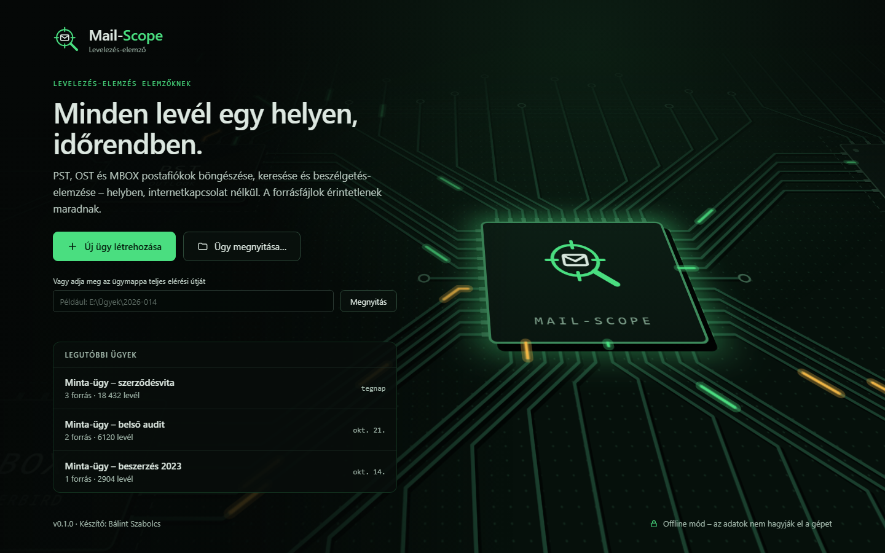
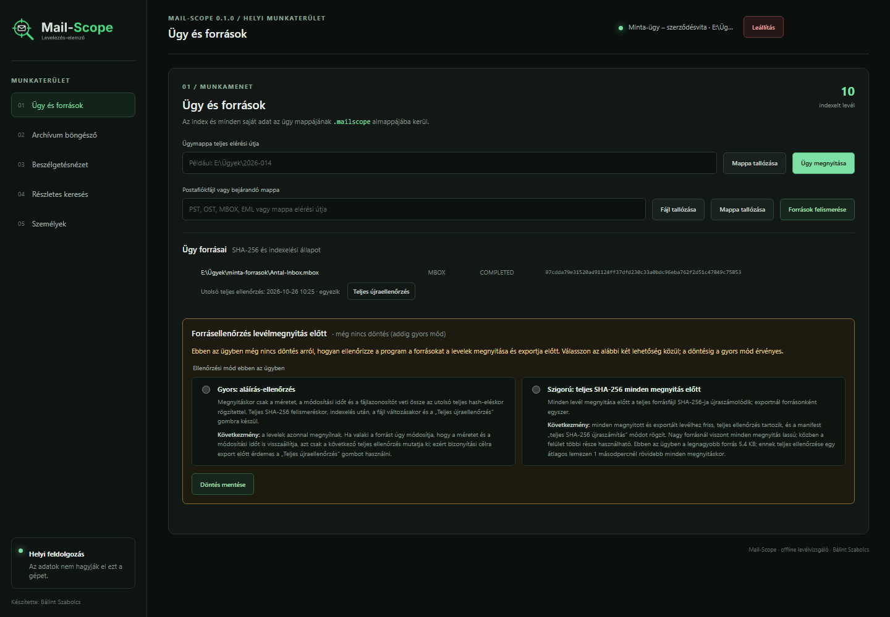
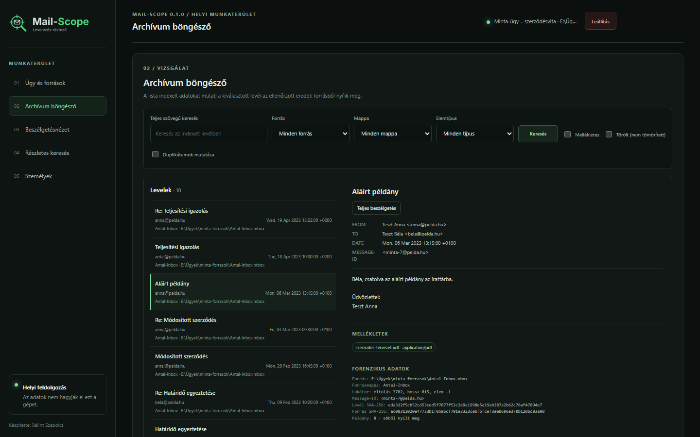
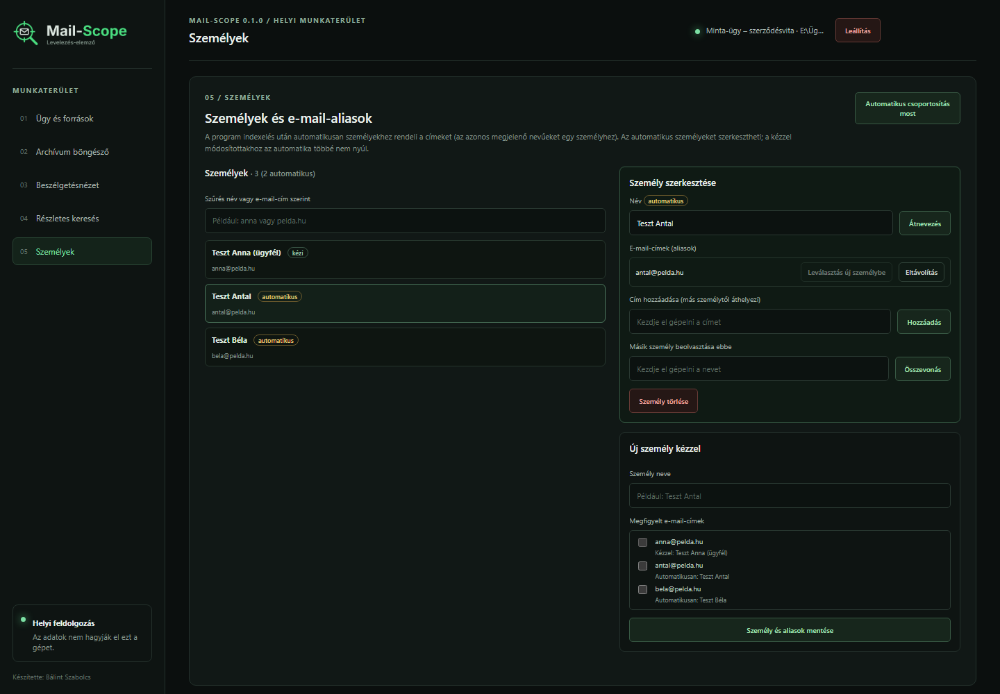
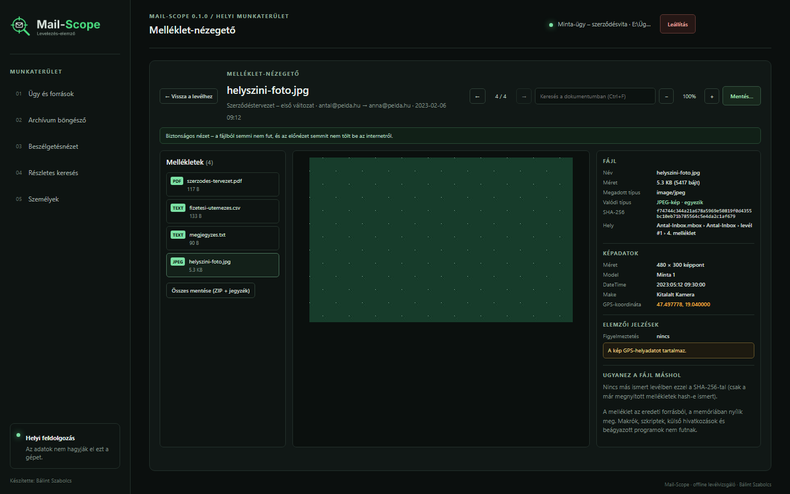
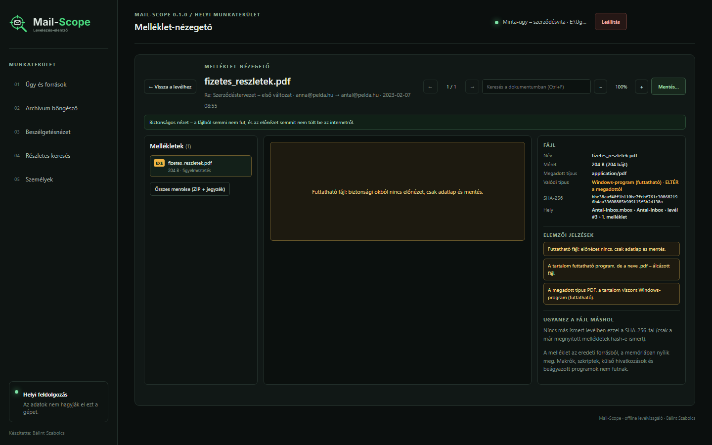
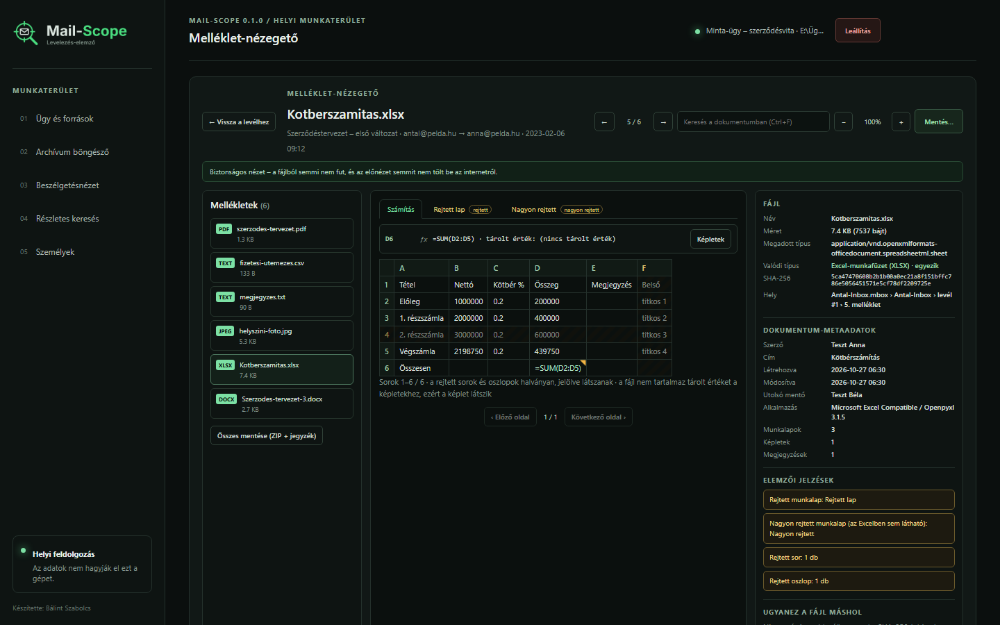
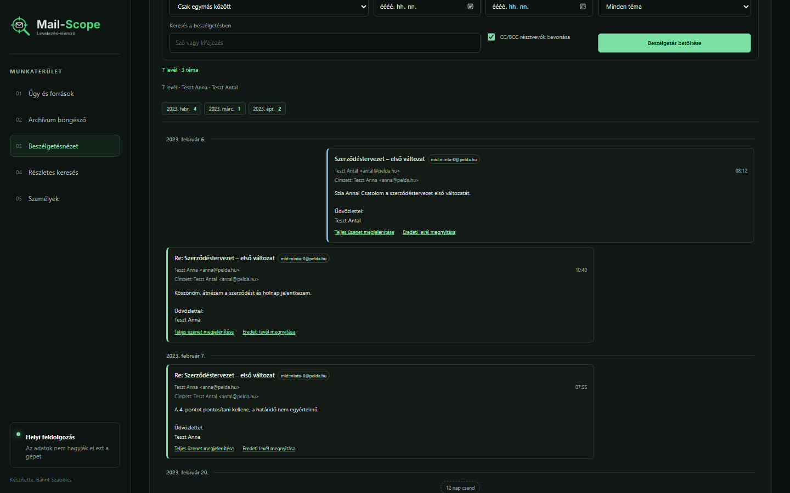
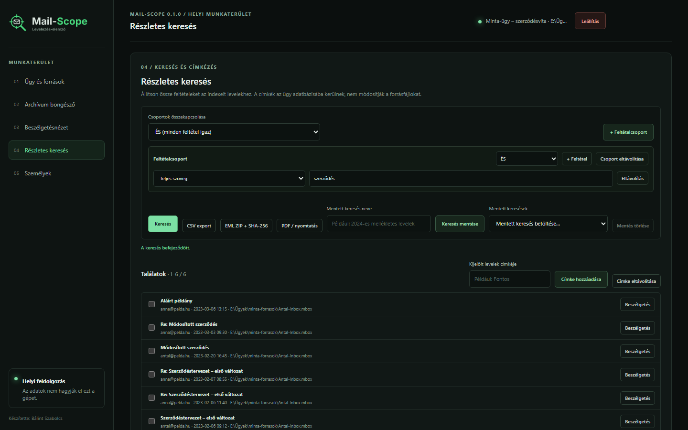

# Mail-Scope

**Készítő: Bálint Szabolcs**

A Mail-Scope offline, helyben futó levélnéző és -elemző program. Közvetlenül olvassa a postafiókforrásokat, a levél-metaadatokat és kereshető tartalmat az ügy SQLite-adatbázisába indexeli, a teljes eredeti levelet pedig kérésre az eredeti forrásból nyitja meg.

> **Fejlesztési állapot:** `0.1.0` verzió. A projekt aktív fejlesztés alatt áll; még nincs aláírt vagy kiadott Windows-alkalmazás. A Mail-Scope MIT-licencű; a külső összetevők a saját licencük alatt maradnak.

## Funkciók

- MBOX, MBX, MBS, EML, PST és OST források felismerése és indexelése, támogatott fájlok rekurzív megtalálásával. Egy mappa EML fájljai (például egy Mail Extractor kimeneti mappa) egyetlen forrást alkotnak.
- PST/OST olvasása az opcionális `libpff-python-windows` kötésen keresztül.
- Keresés levéltörzsben, tárgyban, résztvevők között, dátum, melléklet, mappa, forrás, melléklettípus és ügybeli címke szerint.
- Részletes feltételépítő ÉS/VAGY csoportokkal, menthető és újra betölthető keresésekkel.
- Duplikált levelek összevonása a találatokban, miközben megmaradnak a forráspéldányok és forenzikus lokátorok.
- Címke hozzárendelése a kijelölt levél összes indexelt forráspéldányához.
- Személyalapú beszélgetésnézet és EML-export SHA-256 jegyzékkel.
- Részletes keresési találatok exportja CSV-be vagy EML ZIP-be; korlátozott keresési jelentés nyomtatása/PDF-be mentése a böngészőből.
- Az index, a címkék, a mentett keresések és az ügynapló (`mailscope.log`) az ügy `.mailscope` mappájában maradnak. Az alkalmazásnapló helye: `%LOCALAPPDATA%\Mail-Scope\logs\mail-scope.log`.
- A teljes szöveges keresés szókezdetre illeszt, így a `szerződés` a `szerződést` alakot is megtalálja; pontos kifejezéshez idézőjel, operátorként `AND`, `OR`, `NOT` használható.

## Adatvédelem és forrásintegritás

- A program nem tölt fel adatot, nem használ külső szolgáltatást, CDN-t vagy internetes erőforrást.
- A helyi szerver kizárólag a `127.0.0.1` címen figyel.
- A forrás-postafiókok csak olvashatók. Az ellenőrzésnek két szintje van:
  - **Teljes SHA-256 számítás** történik felismeréskor, indexelés után, valahányszor a forrás fájlaláírása (méret, módosítási idő, fájlazonosító) eltér az utolsó teljes hash-eléskor rögzítettől, valamint ha az **Ügy és források** lapon a forrás melletti **Teljes újraellenőrzés** gombot választja. Az újraellenőrzés a háttérben, folyamatjelzővel fut; eredménye és időpontja az ügy adatbázisába és az ügynaplóba kerül. Eltérő hash esetén a forrás `source_changed` állapotba kerül, és leveleit a program többé nem nyitja meg és nem exportálja.
  - **Csak aláírás-ellenőrzés** történik minden más megnyitáskor és exportkor: ha a méret, a módosítási idő és a fájlazonosító változatlan, a program a legutóbbi teljes hash-t fogadja el a teljes fájl beolvasása nélkül. A módosítási idő szándékosan visszaállítható, ezért friss, teljes bizonyítékhoz használja a **Teljes újraellenőrzés** gombot.
  - A program ügyenként rákérdez az **Ügy és források** lapon, hogy a fenti gyors módot vagy a **szigorú módot** választja: ez minden levél megnyitása előtt a teljes forrás SHA-256-ját újraszámolja (exportnál forrásonként egyszer). A szigorú mód minden megnyitott és exportált levélhez friss, teljes ellenőrzést ad, de nagy PST/OST esetén egy-egy megnyitás percekig tarthat; a lap az ügy legnagyobb forrására becslést is mutat. Döntésig a gyors mód érvényes.
  - Minden forrás sorában látszik az „Utolsó teljes ellenőrzés: <dátum, idő>”, és minden EML ZIP `MANIFEST.txt` levelenként rögzíti, hogy az exportot teljes hash vagy csak aláírás-ellenőrzés előzte-e meg, és mikor volt a forrás utolsó teljes ellenőrzése.
- Az index lokátorokat, metaadatokat és kereshető tartalmat tárol, nem bontja ki a teljes postafiókot. MBOX/EML exportnál a program megőrzi a forrás levélbájtjait (az MBOX envelope sor nélkül); PST/OST esetén a rendelkezésre álló fejlécekből, MAPI-adatokból, törzsből és mellékletekből rekonstruált EML készül.
- A jegyzékben szereplő hash a ZIP-be írt EML pontos bájtjain készül. A PST/OST nem tartalmaz egyetlen eredeti RFC 5322 levélfolyamot, ezért az abból készült EML rekonstrukció, nem bájtpontos eredeti. Minden ZIP tartalmaz egy `SHA256SUMS.txt` és egy `MANIFEST.txt` fájlt; utóbbi minden bejegyzésnél jelzi, hogy eredeti forrásbájt vagy PST/OST-rekonstrukció, és megadja a forrásfájlt, annak SHA-256-ját és a levél helyét.
- A tesztekhez és képernyőképekhez kizárólag kitalált adat használható. Valódi levelet, postafiókot, hitelesítő adatot vagy személyes adatot ne tegyen a repóba.

## Követelmények

- Windows 10/11 x64
- Python 3.13 x64
- SQLite FTS5-támogatással (a támogatott Python-disztribúciók része)
- PST/OST-támogatáshoz `libpff-python-windows`

## Futtatás forrásból

PowerShellben, a repó gyökérmappájából:

```powershell
py -3.13 -m venv .venv
.\.venv\Scripts\python.exe -m pip install -r requirements.txt
.\run_dev.bat
```

A felület automatikusan megnyílik az alapértelmezett böngészőben (alapértelmezésben `http://127.0.0.1:8765`). Forrásból futtatva a szerver leállítható a terminálban a `Ctrl+C` billentyűkkel.

Tesztek futtatása:

```powershell
py -3.13 -m pip install -r requirements-dev.txt
py -3.13 -m unittest discover -v
```

## Windows-alkalmazás buildelése

A `build_windows.bat` létrehozza vagy újrahasználja a `.venv` környezetet, telepíti a rögzített build-függőségeket, majd PyInstallerrel onedir csomagot készít:

```bat
build_windows.bat
```

A futtatható fájl: `dist\Mail-Scope\Mail-Scope.exe`. Futtatáskor a teljes `Mail-Scope` mappát tartsa meg, mert a helyi felület és a harmadik fél licenceiről szóló tájékoztatók is abban vannak. A buildhez szükséges a rögzített PST-kötés, amelyet a PyInstaller csomagol.

Az `.exe` indításakor a program automatikusan megnyitja a helyi felületet az alapértelmezett böngészőben; terminálablak nem jelenik meg. A felület jobb felső sarkában található **Leállítás** gomb megerősítést kér. Futó indexelés esetén jelzi ezt, majd biztonságosan megszakítja az aktuális mentési pontnál. A már elmentett levelek és a folytatáshoz szükséges indexállapot megmarad az ügy `.mailscope` adatbázisában.

## Használat

A teljes, lépésenkénti leírás: [Használati útmutató](./docs/HASZNALATI_UTMUTATO.md).

1. Indítsa el a Mail-Scope-ot. Megnyitott ügy nélkül a nyitóképernyő jelenik meg: hozzon létre új ügyet, nyisson meg egy meglévő ügymappát, vagy válasszon a legutóbbi ügyek közül (ezek a `%APPDATA%\Mail-Scope\recent.json` fájlban tárolódnak, soha nem az ügy- vagy forrásmappában).
2. Az **Ügy és források** lapon adjon meg forrásfájlt vagy mappát, és ellenőrizze a felismert forrásokat.
3. Indítsa el az indexelést. Az oldalsávon a „01” melletti kis jelző bármelyik lapon mutatja, hogy indexelés fut.
4. Használja a munkaterület lapjait: **Archívum böngésző**, **Beszélgetésnézet**, **Részletes keresés** és **Személyek**. A személyek indexelés után automatikusan létrejönnek (az azonos megjelenő nevű címek egy személyhez kerülnek); a **Személyek** lapon átnézheti és szerkesztheti őket.
5. Csak a szükséges eredményeket exportálja. A CSV legfeljebb 10 000, az EML ZIP legfeljebb 500 levelet és 256 MiB exportált levéladatot, a nyomtatható PDF-jelentés legfeljebb 2000 találatot tartalmazhat.

Minden lapnak saját címe van (`#/ugy`, `#/archivum`, `#/beszelgetes`, `#/kereses`, `#/szemelyek`), így a Vissza/Előre gomb és a frissítés is az aktuális lapon marad; beviteli mezőn kívül a `Ctrl+1`…`Ctrl+5` vált lapot. Lapváltáskor megmaradnak a szűrők, a kijelölt levél, a betöltött beszélgetés és a keresési feltételek. Keskeny képernyőn az oldalsáv vízszintes, görgethető lapsávvá alakul. A nyitóképernyő áramköri animációja megáll, ha az ablak rejtett vagy ügy nyílik meg, és egyáltalán nem fut, ha a Windows „Animációk megjelenítése” beállítása ki van kapcsolva (csökkentett mozgás).

A részletes keresés tárgy, teljes szöveg, feladó, címzett, kezdő/záró dátum, melléklet megléte, forrásútvonal, mappa, melléklet MIME-típusa és címke alapján szűr. A feltételek csoportosíthatók, a csoportok között és csoporton belül is választható az ÉS/VAGY kapcsolat.

A mellékletek a beépített **melléklet-nézegetőben** nyílnak meg (az olvasópanelből, a beszélgetés-buborékokból vagy a keresési találatokból): mellékletfa, biztonságos előnézet (PDF-oldalak szövegréteggel, Word-dokumentumok, Excel-munkafüzetek rejtett lapokkal, képletekkel és megjegyzésekkel, szöveg kódolásfelismeréssel, CSV-tábla, PNG-be újrakódolt kép; a HTML- és Word-dokumentumok tisztítva, homokozott keretben jelennek meg; az archívumok, a csatolt Outlook-levelek és a LibreOffice-os „Pontos nézet” későbbi szakaszban jönnek) és elemzői adatlap a valódi típussal, SHA-256-tal, hellyel, figyelmeztetésekkel és az ugyanilyen fájlt tartalmazó más levelekkel. A mellékletből semmi nem fut, nyers fájl nem kerül a böngészőbe, a feldolgozás pedig külön, idő- és memóriakorlátos folyamatban történik. Melléklet csak a **Mentés…** gombbal kerül ki, `.sha256` és eredetleíró fájllal.

A mellékletes leveleknél a találatokban, az Archívum listájában és a beszélgetés-idővonalon gemkapocs és a mellékletek száma látszik; fölé állva a program legfeljebb öt fájlnevet sorol fel. A Keresés gomb melletti **Csak melléklettel** kapcsoló az egész lekérdezést a legalább egy melléklettel rendelkező levelekre szűkíti (ÉS kapcsolattal, akkor is, ha a csoportok között VAGY áll). A mentett keresés megőrzi a kapcsoló állását, a CSV, EML ZIP és PDF export pedig ugyanazt a szűrt halmazt adja; a CSV-ben „Mellékletek száma” és „Mellékletek neve” oszlop is van.

## Ismert korlátozások

- A PST/OST olvasás az opcionális natív `pypff` kötéstől és a libpff képességeitől függ. Sérült vagy nem támogatott Outlook-elemek „hibás” bejegyzésként kerülnek az indexbe; egy sikertelen forrás naplózódik, a többi forrás indexelése folytatódik.
- Az Exchange (`/O=…/CN=…`) címek csak akkor alakulnak SMTP-címmé, ha a postafiók maga tartalmazza a párosítást (például egy címzetttáblában); egyébként az Exchange-cím marad.
- Válaszfejléc nélküli levél csak akkor kerül tárgy alapján egy meglévő szálba, ha válasz/továbbítás előtagja van, van közös résztvevője, és 60 napon belül van.
- A keresési index nem tárol teljes levéltörzset vagy melléklet-tartalmat exportra; az eredeti levelet változatlan forrásból kell újra megnyitni.
- A PDF a böngésző nyomtatási párbeszédablakán keresztül készül, nem beépített PDF-könyvtárral.
- A helyi válaszok méretének korlátozására keresési és exportlimitek vannak.
- A nyilvános közzététel előkészítése még hátravan.

## Harmadik féltől származó összetevők

A Mail-Scope licencét a [LICENSE](./LICENSE) fájl tartalmazza (MIT). A PST/OST-támogatás ettől elkülönülő, LGPL-3.0-or-later licencű `libpff`/`pypff` könyvtárat használ. Részletek: [THIRD_PARTY_NOTICES.md](./THIRD_PARTY_NOTICES.md) és [LICENSES/NOTICE_libpff.txt](./LICENSES/NOTICE_libpff.txt).

## Képernyőképek

Minden képernyőkép kizárólag kitalált postafiókadatot és nevet tartalmaz (Teszt Antal, Teszt Anna, Teszt Béla, `@pelda.hu`).

Nyitóképernyő:



Az ügy forrásai az utolsó teljes ellenőrzéssel és a **Teljes újraellenőrzés** gombbal:



Archívum böngésző megnyitott levéllel és forenzikus adatokkal:



Személyek lap az automatikus csoportosítással és a szerkesztővel:



Melléklet-nézegető az elemzői adatlappal (kép EXIF- és GPS-adattal), illetve egy álcázott futtatható fájl jelzése:







Két személy beszélgetésnézete:



Részletes keresés:


